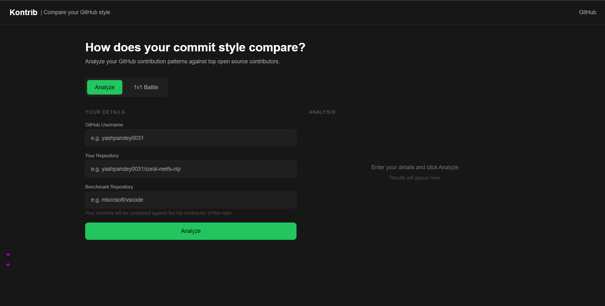
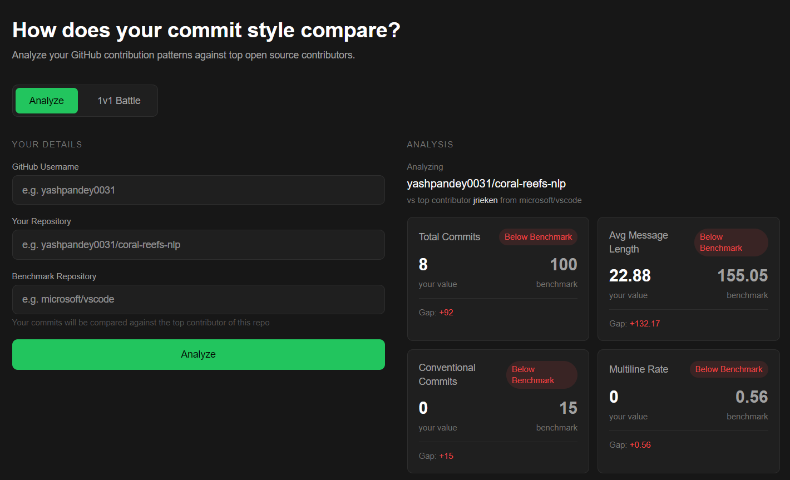
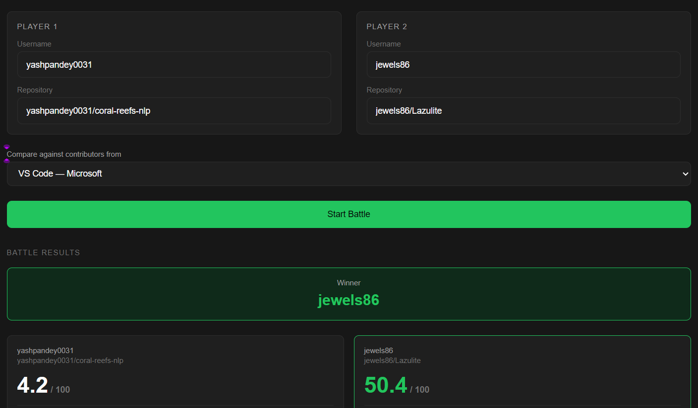

<p align="center">
  
</p>

# Kontrib

Compare your GitHub commit style against top open source contributors. Get AI-powered feedback on what separates your commits from the best in the world.



**Live:** https://kontrib-pi.vercel.app/ · tinkeryard.xyz/kontrib

---

## What it does

**Analyze mode** — Enter your GitHub username and repo, pick a benchmark repo, and get a breakdown of how your commit style compares against the top contributor. Metrics include message length, conventional commit usage, and multiline rate — with LLM feedback grounded in real best practice docs.

**1v1 Battle mode** — Two developers go head to head. Both are scored against a composite benchmark built from the top 5 contributors of a reference repo. Highest score wins.

---

## Screenshots

| Analyze Mode                    | Battle Mode                  |
| ------------------------------- | ---------------------------- |
|  |  |

---

## How it works

```
GitHub API ──> commit signals (length, conventional-commit use, multiline rate)
                      │
                      ├──> compare vs benchmark contributor(s) ──> rating per metric
                      │
                      └──> weak metrics ──> one FAISS query per weak metric
                                                   │
                                      top chunks from best-practice docs
                                                   │
                      commits + metrics + retrieved chunks ──> LLM ──> feedback
```

1. **Signal extraction** (`analyzer.py`): computes commit-message metrics for the user and the benchmark contributor.
2. **Per-metric retrieval** (`llm_client.py`, `rag_engine.py`): each metric the user is weak on maps to its own retrieval query, so the guidelines passed to the LLM depend on what the user actually needs to improve.
3. **Dense retrieval** (`rag_engine.py`): queries are embedded with `BAAI/bge-small-en-v1.5` (via fastembed) and searched in a FAISS inner-product index over normalized vectors (cosine similarity).
4. **Feedback generation** (`llm_client.py`): the LLM is prompted with the user's real commit messages, the metric gaps, and the retrieved guidelines.

---

## Tech Stack

**Backend**

- FastAPI
- FAISS + fastembed (`bge-small-en-v1.5`) — dense retrieval over a best-practice knowledge base
- Groq (`openai/gpt-oss-20b`) — LLM analysis
- GitHub REST API — data fetching
- Python

**Frontend**

- React + TypeScript
- Tailwind CSS
- Vite

---

## Project Structure

```
Kontrib/
├── backend/
│   ├── main.py                  # FastAPI app entry point
│   ├── github_client.py         # GitHub API calls
│   ├── analyzer.py              # Commit signal extraction and scoring
│   ├── llm_client.py            # LLM provider + per-metric retrieval
│   ├── rag_engine.py            # FAISS dense retrieval (+ keyword baseline for eval)
│   ├── build_index.py           # Chunks the knowledge base and builds the FAISS index
│   ├── knowledge_index.faiss    # Built index (commit together with the chunks file)
│   ├── knowledge_chunks.json    # Chunk texts, same order as the index
│   ├── routers/
│   │   └── analysis.py          # /analyze and /battle endpoints
│   ├── eval/
│   │   ├── queries.json         # Retrieval eval queries
│   │   ├── label_chunks.py      # Hand-labeling tool (pooled, blind to retriever)
│   │   ├── golden.json          # Hand-labeled relevance grades
│   │   ├── run_eval.py          # Keyword vs dense comparison
│   │   └── results_*.json       # Saved eval runs
│   └── .env                     # API keys (not committed)
├── frontend/
│   └── src/
│       ├── App.tsx
│       ├── api/kontrib.ts       # API calls
│       ├── components/          # Navbar, forms, results, metrics cards
│       └── types/index.ts       # TypeScript interfaces
└── knowledge_base/              # Best practice docs for RAG
    ├── commit_best_practises.md
    ├── conventional_commits.md
    ├── kernel_contribution.md
    └── open_source_guide.md
```

---

## Setup

**1. Clone the repo**

```bash
git clone https://github.com/yashpandey0031/kontrib
cd kontrib
```

**2. Backend**

```bash
cd backend
python -m venv .venv
.venv\Scripts\activate       # Windows
source .venv/bin/activate    # Mac/Linux
pip install -r requirements.txt
```

Create `backend/.env`:

```
GITHUB_TOKEN=your_github_token
GROQ_API_KEY=your_groq_key
```

Get a free Groq key at [console.groq.com](https://console.groq.com).
Get a GitHub token at [github.com/settings/tokens](https://github.com/settings/tokens) — select `public_repo` scope.

Run:

```bash
uvicorn main:app --reload
```

The first start downloads the embedding model once; later starts reuse the cached copy.

**3. Frontend**

```bash
cd frontend
npm install
npm run dev
```

Open `http://localhost:5173`.

### Rebuilding the index

If you edit anything in `knowledge_base/`, rebuild from `backend/`:

```bash
python build_index.py
```

This rewrites `knowledge_index.faiss` and `knowledge_chunks.json` together. Always commit both files in the same commit — the index and the chunk list must stay in the same order.

---

## Evaluation

The retriever is evaluated on a hand-labeled set instead of being assumed to work.

- **Queries:** 20 queries about commit-message practice (`backend/eval/queries.json`).
- **Labeling:** for each query, the top 5 chunks from both retrievers are pooled and shuffled, then graded 0/1/2 by hand without knowing which retriever returned them. Pooling avoids biasing the benchmark toward one method.
- **Compared:** the original keyword-overlap retriever vs. FAISS dense retrieval, top-3.

| Retriever          | Hit@3 | Recall@3 |   MRR | nDCG@3 | Avg latency |
| ------------------ | ----: | -------: | ----: | -----: | ----------: |
| Keyword (baseline) | 0.950 |    0.350 | 0.850 |  0.685 |     2.1 ms  |
| FAISS dense        | 0.950 |    0.321 | 0.825 |  0.683 |     5.0 ms  |

_n = 20 queries, evaluated 2026-11-26._

**Reading the result:** the two retrievers are statistically indistinguishable at this scale. The knowledge base is small (323 chunks from 4 documents) and the queries share vocabulary with the documents, which favors keyword matching. Recall@3 is capped because many queries have more than three relevant chunks.

**What this does not show:** whether dense retrieval wins on paraphrased queries or a larger, more varied knowledge base. That is the next experiment (see below).

Reproduce from `backend/`:

```bash
python eval/label_chunks.py    # label results (resumable)
python eval/run_eval.py        # print the comparison table, save results_*.json
```

---

## LLM Configuration

Kontrib uses Groq by default (free). To swap providers, update `backend/.env` and change the provider logic and `MODEL` in `llm_client.py`:

| Provider             | Key                 |
| -------------------- | ------------------- |
| Groq (default, free) | `GROQ_API_KEY`      |
| OpenAI               | `OPENAI_API_KEY`    |
| Anthropic            | `ANTHROPIC_API_KEY` |

---

## Knowledge base sources

- opensource.guide/how-to-contribute
- kernel.org/doc/html/latest/process/submitting-patches.html
- docs.github.com/en/communities/setting-up-your-project-for-healthy-contributions
- conventionalcommits.org
- cbea.ms/git-commit (How to Write a Git Commit Message)

---

## Roadmap

**Retrieval / evaluation**

- [ ] Add paraphrased queries and grow the query set to 50+
- [ ] Hybrid retrieval (keyword + dense, reciprocal rank fusion) added to the eval
- [ ] Scale the knowledge base and track Hit@3 / nDCG@3 against size
- [ ] Eval the final LLM feedback (grounding, specificity), not just retrieval

**Product**

- [ ] Fix conventional-commit detection (scoped prefixes like `feat(api):`, capitalized types) and report a true rate
- [ ] MCP server
- [ ] More signals for improving accuracy
- [ ] GitHub auth
- [ ] Message when LLM feedback is unavailable / limit reached
- [ ] Loader for initial model loading
- [ ] Messages explaining each metric
- [ ] Autocomplete or search
- [x] Update the README
- [x] Support for other AI models
- [x] Replace keyword matching with real FAISS dense retrieval
- [x] Retrieval eval harness with hand-labeled golden set

---
